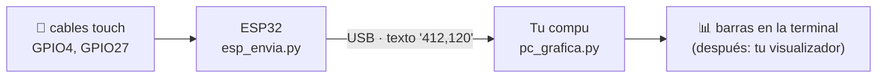

# 03 · De la ESP32 a tu compu

Hasta aquí todo corría **dentro** de la ESP32. El proyecto final necesita que la
ESP32 **mida** y que tu compu **muestre**. Esta carpeta es ese puente.



| Archivo | Corre en | Hace |
|---|---|---|
| `esp_envia.py` | ESP32 (MicroPython) | Lee los sensores y manda una línea CSV cada 50 ms |
| `pc_grafica.py` | Tu compu (Python + pyserial) | Lee esas líneas y las dibuja |

## Pasos

**1. Instala el programa en la ESP32** como `main.py`, para que corra solo al encender:

```bash
uv run mpremote cp 03_esp_a_python/esp_envia.py :main.py + reset
```

**2. Escucha desde tu compu:**

```bash
uv run python 03_esp_a_python/pc_grafica.py
```

Toca los cables y mira cómo cambian las barras. `Ctrl+C` para salir.

**3. Cuando termines**, quita el `main.py` para que la ESP32 quede libre:

```bash
uv run mpremote rm :main.py + reset
```

## Para tu proyecto

- **Más sensores:** agrega pines a `PINES_TOUCH` en `esp_envia.py`. `pc_grafica.py` se adapta solo.
- **Otro visualizador:** solo cambia la función `dibujar()` de `pc_grafica.py`
  (con `uv add matplotlib`, `uv add pygame`, etc.).
- **Ajusta los números:** `VALOR_MAXIMO` y `UMBRAL_TOQUE` dependen de tus cables
  y de lo que toques. Mira los valores primero y luego elige.

> No puedes usar `mpremote` y `pc_grafica.py` al mismo tiempo: los dos quieren el mismo puerto.
