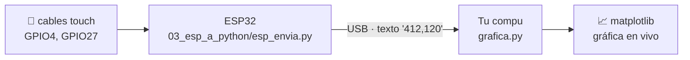

# 04 · Gráfica en vivo con matplotlib

Lo mismo que la 03, pero en vez de barras en la terminal, una **gráfica que se mueve**:
una línea por sensor, la línea punteada del umbral y un título que dice qué sensor estás tocando.



**El circuito y el programa de la ESP32 son los mismos de la 03.** Solo cambia lo que corre en tu compu.

## Pasos

**1. Asegúrate de tener las librerías** (la 04 agrega `matplotlib`):

```powershell
uv sync
```

**2. La ESP32 debe tener `esp_envia.py` como `main.py`.** Si ya lo hiciste en la 03, sáltate esto:

```powershell
uv run mpremote cp 03_esp_a_python/esp_envia.py :main.py + reset
```

**3. Abre la gráfica:**

```powershell
uv run python 04_grafica_en_vivo/grafica.py
```

Toca los cables y mira cómo bajan las líneas. **Cierra la ventana** para salir.

## Cómo está hecho

| Parte de `grafica.py` | Qué hace |
|---|---|
| `leer_nuevos()` | Lee todo lo que llegó por USB desde la última vez, sin quedarse esperando |
| `deque(maxlen=PUNTOS)` | Guarda solo las últimas 200 lecturas: lo viejo se borra solo |
| `FuncAnimation(..., interval=50)` | Llama a `actualizar()` cada 50 ms para redibujar |
| `actualizar()` | Agrega los datos nuevos, redibuja las líneas y cambia el título |

## Ajustes

| Constante | Para qué |
|---|---|
| `UMBRAL_TOQUE` | Abajo de este valor se considera "tocado". Mira tus números sin tocar y tocando, y elige uno en medio |
| `PUNTOS` | Cuánto tiempo se ve en pantalla (más puntos = más historia) |
| `CADA_MS` | Cada cuánto se redibuja (si tu compu va lenta, súbelo a 100) |

## Retos

- Agrega un tercer sensor en `PINES_TOUCH` de `esp_envia.py` (por ejemplo el GPIO32). La gráfica crea la línea nueva sola.
- Pinta el fondo de la gráfica de otro color mientras alguien toca un sensor.
- Cuenta cuántas veces se tocó cada sensor y muéstralo en la leyenda.
- Guarda las lecturas en un `.csv` para analizarlas después.

> No puedes usar `mpremote`, `pc_grafica.py` y `grafica.py` al mismo tiempo: todos quieren el mismo puerto.
