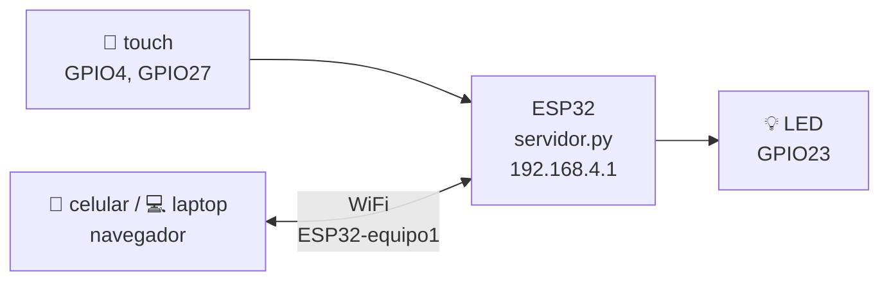

# 05 · Servidor web en la ESP32

Hasta la 04 la ESP32 hablaba con tu compu **por el cable USB**. Ahora habla **por WiFi**:
la ESP32 crea su propia red, y desde cualquier celular o laptop abres una página
donde ves los sensores en vivo y prendes o apagas el LED.



## Circuito

El LED de la [01](../01_led_parpadeo/) y los cables touch de la [03](../03_esp_a_python/), juntos:

| Pin | Va a |
|---|---|
| GPIO23 | resistencia 220 Ω → LED → GND |
| GPIO4 | cable touch 1 |
| GPIO27 | cable touch 2 |

## Pasos

**1. Ponle nombre a tu red.** Abre `servidor.py` y cambia `NOMBRE_RED` (por ejemplo
`ESP32-equipo3`). Si todos los equipos dejan el mismo nombre, nadie va a saber a cuál se conecta.

**2. Arranca el servidor:**

```powershell
uv run mpremote run 05_servidor_web/servidor.py
```

La terminal dice algo como:

```
📶 Red WiFi creada: ESP32-equipo3  clave: proyecto123
🌐 Abre en el navegador:  http://192.168.4.1
```

**3. Conéctate desde el celular** a la red `ESP32-equipo3` (clave `proyecto123`) y abre
**http://192.168.4.1**. El celular puede avisar que esa red "no tiene internet": es normal, quédate conectado.

**Detener:** `Ctrl+C` en la terminal y luego el botón **EN** de la tarjeta.

> ¿Quieres que funcione sin la compu? Guárdalo como `main.py`:
> `uv run mpremote cp 05_servidor_web/servidor.py :main.py + reset`.
> Así la ESP32 arranca el servidor sola con cualquier cargador USB.

## Cómo funciona

Un servidor web es un programa que **espera** a que alguien le pida algo y **contesta**.
El navegador pide una **ruta** y la ESP32 responde según cuál sea:

| El navegador pide | La ESP32 contesta |
|---|---|
| `/` | La página (HTML con estilos y un poco de JavaScript) |
| `/datos` | Los valores de los sensores, como texto JSON: `{"sensores": [520, 118], "led": 1, "umbral": 200}` |
| `/led/on` | Prende el LED y contesta `ok` |
| `/led/off` | Apaga el LED y contesta `ok` |
| cualquier otra | `404 No existe` |

La página pide `/datos` cada 300 ms con JavaScript (`fetch`) y redibuja las tarjetas.
Puedes probar las rutas directo en el navegador: escribe `http://192.168.4.1/datos`.

En `servidor.py`:

| Función | Qué hace |
|---|---|
| `crear_red_propia()` | Activa el WiFi de la ESP32 en modo **punto de acceso** (ella es el módem) |
| `iniciar_servidor()` | Abre el puerto 80 y se queda en un ciclo: aceptar → atender → cerrar |
| `atender()` | Lee la ruta que pidió el navegador y decide qué contestar |
| `leer_datos()` | Lee los sensores y los arma como JSON |

## ¿Y el WiFi de mi casa?

Cambia `MODO = "wifi"` y llena `WIFI_RED` y `WIFI_CLAVE`. La ESP32 se une a esa red y la
terminal te dice su dirección (algo como `http://192.168.1.57`). Tu celular debe estar en la misma red.

⚠️ Las redes de la escuela que piden **usuario y contraseña** no funcionan con la ESP32.
Para eso es el modo `"ap"`, o el hotspot de tu celular.

## Retos

- Agrega un botón que haga parpadear el LED 5 veces.
- Agrega un tercer sensor touch (GPIO32) a la lista `sensores`; la página lo muestra sola.
- Ponle un slider a la página para controlar el brillo del LED con PWM (mira la [02.3](../02_tipos_de_pin/3_salida_pwm_brillo_led.py)).
- Cuenta cuántas veces se ha tocado cada sensor y muéstralo en la página.
