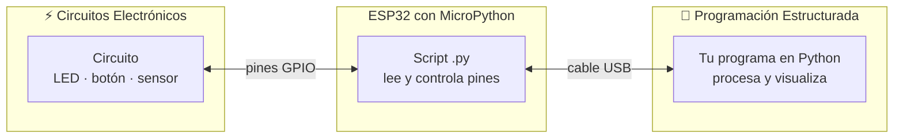
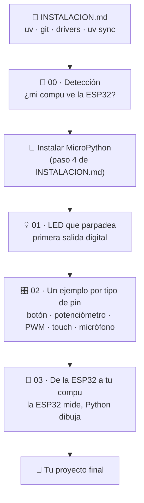

# Proyecto final · ESP32 + Python

**Programación Estructurada × Circuitos Electrónicos** — CUTLAJO

Este repo es la **semilla** de tu proyecto final. Te lleva paso a paso desde
"¿mi compu ve la tarjeta?" hasta "la ESP32 mide algo y mi programa en Python lo muestra".



La ESP32 también se programa en **Python** (MicroPython), así que todo el
proyecto, de punta a punta, es Python.

---

## Ruta: de menos a más



| Paso | Carpeta | Corre en | Lo que aprendes |
|---|---|---|---|
| 0 | [`INSTALACION.md`](INSTALACION.md) | — | Dejar el entorno listo en Windows, Linux o Mac |
| 1 | [`00_deteccion_esp/`](00_deteccion_esp/) | 💻 compu | Que tu sistema vea la ESP32 y hable con ella |
| 2 | [`01_led_parpadeo/`](01_led_parpadeo/) | 🔲 ESP32 | Salida digital, ley de Ohm, tu primer circuito |
| 3 | [`02_tipos_de_pin/`](02_tipos_de_pin/) | 🔲 ESP32 | Entrada digital, ADC, PWM, touch, sensores |
| 4 | [`03_esp_a_python/`](03_esp_a_python/) | 🔲 + 💻 | Mandar datos por USB y visualizarlos en Python |

---

## Arranque rápido

```bash
git clone https://github.com/strahlenguy/esp32.git mi-proyecto
cd mi-proyecto
uv sync                                         # crea el entorno (Python + librerías)

uv run python 00_deteccion_esp/windows.py       # o linux.py / mac.py
uv run mpremote run 01_led_parpadeo/parpadeo.py # ¡LED parpadeando!
```

¿Es la primera vez? Sigue [`INSTALACION.md`](INSTALACION.md) completo.

---

## ¿Qué corre dónde?

Hay **dos tipos** de archivo `.py` en este repo. Cada uno lo dice en su primera línea.

| | 🔲 Corre **en la ESP32** | 💻 Corre **en tu compu** |
|---|---|---|
| Lenguaje | MicroPython | Python normal |
| Usa | `machine`, `Pin`, `ADC`, `PWM`, `TouchPad` | `pyserial`, `matplotlib`, lo que quieras |
| Se corre con | `uv run mpremote run archivo.py` | `uv run python archivo.py` |
| Ejemplos | `01_led_parpadeo/`, `02_tipos_de_pin/`, `esp_envia.py` | `00_deteccion_esp/`, `pc_grafica.py` |

---

## Estructura

```
.
├── README.md                 ← estás aquí
├── INSTALACION.md            ← empieza por aquí
├── pyproject.toml            ← dependencias del proyecto (uv)
├── uv.lock                   ← versiones exactas (no lo edites a mano)
├── .python-version           ← versión de Python que usa uv
├── firmware/                 ← aquí guardas el .bin de MicroPython
├── 00_deteccion_esp/
│   ├── windows.py
│   ├── linux.py
│   ├── mac.py
│   └── comun.py              ← lo que comparten los tres
├── 01_led_parpadeo/
│   └── parpadeo.py
├── 02_tipos_de_pin/
│   ├── 1_entrada_digital_boton.py
│   ├── 2_entrada_analogica_potenciometro.py
│   ├── 3_salida_pwm_brillo_led.py
│   ├── 4_touch_capacitivo.py
│   └── 5_sensor_de_sonido.py
└── 03_esp_a_python/
    ├── esp_envia.py          ← 🔲 en la ESP32
    └── pc_grafica.py         ← 💻 en tu compu
```

---

## Pines usados en los ejemplos

```
                    ESP32 DevKit (vista superior)
                 ┌───────────────────────────┐
                 │         [ antena ]        │
            3V3 ─┤ ●                       ● ├─ GND
                 │                           │
  potenciómetro ─┤ ● GPIO34         GPIO23 ● ├─ LED (+220 Ω)
   micrófono AO ─┤ ● GPIO35         GPIO18 ● ├─ botón
                 │                           │
                 │                   GPIO4 ● ├─ touch 1
   touch 2 ──────┤ ● GPIO27                  │
                 │                   GPIO2 ● ├─ LED azul de la placa
                 │       [EN]  USB  [BOOT]   │
                 └───────────────────────────┘
```

> La posición física de los pines cambia entre modelos de DevKit (30 o 38 pines).
> **Guíate por la serigrafía de tu tarjeta**, no por la posición del dibujo.

---

## Problemas comunes

| Síntoma | Solución |
|---|---|
| La compu no ve la tarjeta | Cambia el cable (muchos solo cargan) y revisa el driver → `00_deteccion_esp/` |
| `Permission denied` (Linux) | `sudo usermod -aG dialout $USER` y vuelve a iniciar sesión |
| `busy` / `Acceso denegado` | Otro programa tiene el puerto: cierra Arduino IDE, Thonny o la otra terminal |
| `could not enter raw repl` | La ESP32 no tiene MicroPython → paso 4 de `INSTALACION.md` |
| Grabando: `Failed to connect` | Mantén el botón **BOOT** mientras dice `Connecting....` |
| El script corre pero el circuito no hace nada | Revisa GND común, la orientación del LED y que el pin sea el correcto |

---

## Documentación útil

- MicroPython para ESP32 — referencia rápida: <https://docs.micropython.org/en/latest/esp32/quickref.html>
- `mpremote`: <https://docs.micropython.org/en/latest/reference/mpremote.html>
- `uv`: <https://docs.astral.sh/uv/>
